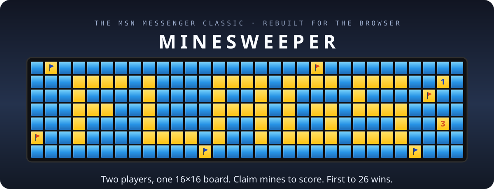
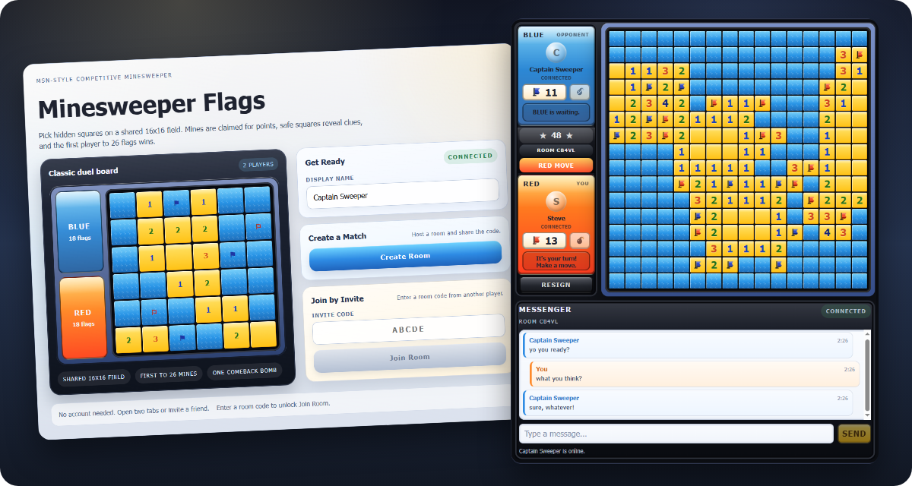

<p align="center">
  
</p>

<div align="center">

[](https://www.typescriptlang.org)
[](https://react.dev)
[](https://vite.dev)
[](https://nodejs.org)
[](LICENSE)
[](docs/p2p-architecture.md)

</div>

This is an homage to the MSN Messenger game I used to play with friends back in the day. It is realtime two-player competitive Minesweeper with room chat, and it runs in the browser.

## How to play

- One player creates a room or hosts a direct match.
- The other player joins with an invite link, an invite token, or a direct-match join URL.
- Both players share a 16×16 board with 51 mines and take turns.
- Find a mine and you claim it. The first player to 26 mines wins.
- Each player gets one 5×5 bomb as a comeback move. It unlocks only while that player trails by 4 or more.
- Chat stays with the room through reconnects and rematches.

<p align="center">
  
</p>

## Two ways to run it

One codebase builds two product shapes. `VITE_DEPLOYMENT_MODE` selects the shape at build time.

| Shape | Mode | Who owns the game |
| --- | --- | --- |
| **Hosted server** | `server` | A Node WebSocket server in `apps/server` runs rooms, matches, and chat. Players share room codes and invite links. |
| **Direct match** | `p2p` | The host's browser runs the match over a WebRTC data channel. A small HTTP signaling service in `apps/signaling` only brokers the connection and short reconnects. |

"Direct match" is the product name. `p2p` is the technical mode name. They are the same thing.

## How it works

```text
apps/
  client/         React + Vite frontend (server and p2p builds)
  server/         Node + ws realtime server (hosted flow)
  signaling/      HTTP signaling service (p2p flow)
packages/
  game-engine/    Pure game rules and board logic
  shared/         Schemas, DTOs, and protocol types used by every app
```

- The game rules are pure and deterministic. The same engine runs on the server and in the host browser.
- The client is transport-neutral. Its controller sends the same commands and receives the same events over a `ws` socket or an `RTCDataChannel`.
- In direct-match mode, `P2PHostOrchestrator` in the host browser owns the room, match, and chat state. Guests reconnect into the host.
- The signaling service never stores gameplay state. It holds only offer/answer rendezvous rows and short-lived reconnect control sessions.
- Both services validate input against `packages/shared` schemas. They also apply per-IP rate limits and an origin allowlist. Redis-backed state is optional.

[`docs/p2p-architecture.md`](docs/p2p-architecture.md) covers the direct-match design in full: the handshake, reconnect control sessions, duplicate-tab displacement, and recovery storage.

## Quick start

You need Node and npm. Docker is needed only for the Compose stacks.

```bash
make install
make dev        # hosted server flow: server + client in watch mode
make p2p-dev    # direct-match flow: signaling + client in watch mode
```

Open the Vite URL that the command prints. To play against yourself, open a second tab and join the room.

To run the full stack in containers, use `make compose-up` (hosted) or `make compose-p2p-up` (direct match), then open `http://localhost:8080`.

## Development

```bash
make help       # list every target
make test       # all workspace tests (Vitest)
make check      # tests, build, and Compose config validation
```

There are also per-workspace targets: `make test-client`, `make test-server`, `make test-signaling`, `make test-shared`, and `make test-engine`.

Before a public deploy, test a parity stack. These stacks match the public deployment shape, with split origins and Redis.

- `make compose-public-up` (hosted) runs with built-in localhost defaults.
- `make compose-public-p2p-up` (direct match) fails fast until you set `VITE_P2P_SIGNALING_URL`, `SIGNALING_ALLOWED_ORIGINS`, and `CSP_CONNECT_SRC`. Start from [`deploy/container/public.p2p.env.example`](deploy/container/public.p2p.env.example).

## Configuration

- [`docs/config-reference.md`](docs/config-reference.md) lists every environment variable, make target, Compose stack, and health endpoint, with recipes.
- [`deploy/container/README.md`](deploy/container/README.md) covers the public and parity Compose overlays.
- Example env files: [`apps/server/.env.example`](apps/server/.env.example), [`apps/client/.env.example`](apps/client/.env.example), [`apps/client/.env.production.example`](apps/client/.env.production.example), [`deploy/container/public.env.example`](deploy/container/public.env.example), and [`deploy/container/public.p2p.env.example`](deploy/container/public.p2p.env.example).

Public mode (`DEPLOYMENT_MODE=public`) fails fast unless Redis, an explicit origin allowlist, and `TRUST_PROXY=true` are set.

## Limits

- Deployments are single-instance. Cross-instance fanout is not implemented, so horizontal scaling needs more work.
- Public deployments should use Redis-backed state.
- Direct matches need the two browsers to reach each other over WebRTC. Configure STUN servers with `VITE_P2P_STUN_URLS`.

## License

The code is released under the [MIT License](LICENSE). Minesweeper Flags was originally a Microsoft game for MSN Messenger. This project is an independent fan rebuild and is not affiliated with or endorsed by Microsoft.
